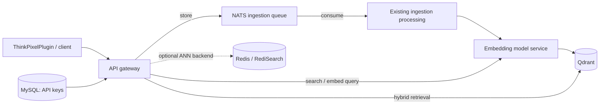

# ThinkPixelSR

**Standalone hybrid search and retrieval infrastructure for the ThinkPixel ecosystem.**

ThinkPixelSR is the continuation of [ThinkPixelInfra](https://github.com/bdobrica/ThinkPixelInfra). It provides the existing search and retrieval-augmented generation (RAG) infrastructure used by [ThinkPixelPlugin](https://github.com/bdobrica/ThinkPixelPlugin), including asynchronous document ingestion and hybrid vector retrieval. The immediate objective is **to preserve this working MVP while making it reproducible, operable, and understandable**—not to redesign its architecture.

> **Status:** Existing standalone MVP; repository migration and operator-experience makeover in progress. This is not a claim of production qualification or integration with the wider agent platform. See [PLAN.md](PLAN.md) for scope and [TODO.md](TODO.md) for the implementation sequence.

## What it does

- Exposes a search and document-ingestion API through the existing authenticated gateway.
- Accepts documents for asynchronous processing over NATS.
- Produces embeddings using the existing model containers (including Snowflake Arctic).
- Uses Qdrant for hybrid retrieval, with Redis/RediSearch retained as an existing optional alternative with different retrieval capabilities.
- Supports a WordPress search use case via the separately maintained [ThinkPixelPlugin](https://github.com/bdobrica/ThinkPixelPlugin).
- Deploys existing infrastructure to Hetzner Cloud using Terraform/Terragrunt and Kubernetes services through FluxCD GitOps.

These describe the inherited implementation, not a commitment to add new functionality.

## Architecture



The diagram is deliberately conceptual; use the manifests and code in this repository to establish exact service topology and APIs. The Redis option is **not** claimed to have parity with Qdrant hybrid search. MySQL, NATS, model serving, gateway, and retrieval responsibilities remain unchanged during this makeover.

## Repository layout

The committed implementation has been imported from the frozen ThinkPixelInfra
revision, retaining its Git history and functional paths. See the
[Phase 1 evidence](docs/evidence/phase-1/README.md) and
[migration and rollback guide](docs/migration.md). GitHub publication remains
unverified; the existing Flux source still points to ThinkPixelInfra.

| Path | Existing responsibility |
| --- | --- |
| `cluster/` | Hetzner provisioning with Terraform/Terragrunt; environment roots in `cluster/live/dev` and `cluster/live/prod` |
| `k8s/` | Kubernetes declarations and FluxCD-managed workloads |
| `docker/` | API gateway, embedding models, Redis Sentinel, and WordPress image/configuration assets |
| `database/` | MySQL schema and migration artifacts |
| `local/` | Local-development resources and mock site |
| `debug/` | Debugging utilities |
| `.github/workflows/` | Existing image-publishing automation, inventoried and preserved during import |
| `docs/` | Phase 0 baseline, Phase 1 migration/evidence and draft verification; final operator guides follow in later phases |

## Getting started

The inherited [cluster setup instructions](cluster/README.md) are now present
locally. Read their migration caveat and the [infrastructure baseline](docs/baseline/infrastructure.md)
before using them: production configuration is empty and authoritative state
has not been located. The commands below are the **target experience**, not a
claim that a root Makefile or `.env.example` already exists. Check
[TODO.md](TODO.md) for implementation status before running them.

For a credential-free entry point, the existing command is `make -C local help`.
Local service startup and integration tests can mutate data; consult the
[verification specification](docs/operations/verification.md) first.

### Prerequisites

- Terraform and Terragrunt versions compatible with the checked-in configuration and lockfiles.
- Hetzner Cloud access and relevant DNS access; required cloud/DNS tokens.
- SSH key material matching the current Terragrunt configuration.
- `make`, a shell, `kubectl`, `flux`, and the existing container build/push tools as required by each operation.
- A container registry and permission to push model images when publishing images.
- A secure location for credentials and Terraform state; do not commit secrets, private SSH keys, `.env`, generated kubeconfigs, or state.

### Intended operator workflow (to be implemented and validated)

```bash
git clone https://github.com/bdobrica/ThinkPixelSR.git
cd ThinkPixelSR
cp .env.example .env
# Edit .env; provision credentials/SSH keys using docs/configuration.md.
make help
make doctor
make config-check
make cluster-plan ENV=dev
make cluster-up ENV=dev             # explicit approval after reviewing plan
make flux-bootstrap ENV=dev         # only after cluster access is verified
make status ENV=dev
```

The wrapper must preserve the existing Terragrunt input schema and FluxCD reconciliation model. Secrets may be referenced from `.env` **only as local paths or securely sourced environment values**; avoid expanding their contents into printed shell commands or logs. The precise variable names and bootstrap sequence must be documented after inspecting all source manifests and workflows.

### Planned operational targets

| Target | Expected meaning | Risk |
| --- | --- | --- |
| `help`, `doctor`, `config-check` | Discover tasks, check tools, validate local configuration | Read-only |
| `cluster-init`, `cluster-plan` | Initialize and preview the chosen Terragrunt environment | No intentional infrastructure mutations (init may modify local metadata / backend setup) |
| `cluster-up` | Apply a reviewed plan to create/update Hetzner infrastructure | Changes live resources |
| `cluster-scale` | Change **worker-pool** capacity via existing inputs, show plan, require approval | Changes live resources; may remove nodes |
| `flux-check`, `flux-bootstrap` | Inspect prerequisites; install/bootstrap existing GitOps setup when appropriate | Bootstrap changes cluster/Git state |
| `images-build`, `images-push` | Build/publish existing model images with explicit tags | Push creates registry artifacts |
| `status`, `verify` | Check health, configuration, and documented smoke path | Primarily read-only |

No default destroy target, no unconditional `terraform apply -auto-approve`, and no implicit worker-pool shrink. For scaling, prefer editing the **existing** worker pool counts and reviewing `make cluster-plan`; `cluster-scale` must be an explicit, guarded convenience wrapper around that procedure.

## Documentation

Phase 0 is recorded against the local ThinkPixelInfra source and separate plugin checkout:

- [Architecture draft and component inventory](docs/architecture.md).
- [Infrastructure versions, dev/prod configuration and state preservation](docs/baseline/infrastructure.md).
- [GitOps, storage, secrets and migration reference checklist](docs/baseline/gitops.md).
- [Image build and publishing map](docs/baseline/images.md).
- [Offline verification and API/WordPress smoke specification](docs/operations/verification.md).
- [Observed evidence, frozen file inventory and live validation gaps](docs/evidence/phase-0/README.md).
- [Repository coexistence, publication, GitOps cutover and rollback](docs/migration.md).
- [Phase 1 import comparison and retained history](docs/evidence/phase-1/README.md).

The baseline does not claim a successful live dev or WordPress run. The final operator
guides below remain **planned deliverables**, tracked in [TODO.md](TODO.md):

- `docs/architecture.md` — finalize the Phase 0 draft after implementation import and validation.
- `docs/configuration.md` — `.env` contract, secret handling and mapping to existing configuration.
- `docs/deployment/hetzner.md` — bootstrap and cluster provisioning.
- `docs/deployment/fluxcd.md` — GitOps bootstrap, reconciliation, and troubleshooting.
- `docs/operations/scaling.md` — safe worker-pool scaling and rollback.
- `docs/operations/images.md` — building, tagging, and pushing model images.
- `docs/operations/verification.md` — validate the Phase 0 smoke specification against the live plugin path.
- `docs/operations/troubleshooting.md` — known diagnostics and operational recovery.

## Relationship to ThinkPixel

[ThinkPixel](https://github.com/bdobrica/ThinkPixel) catalogs Search/RAG as an **adjacent**, independently maintained component. ThinkPixelSR does not take responsibility for agent governance, agent runtime, tool enforcement, model-provider gateway, or durable agent memory. Any future cross-component integration requires a separate proposal; it is **out of scope** for this repository makeover.

## Development and contribution

Review [AGENTS.md](AGENTS.md) before making changes. The makeover should primarily modify documentation, build/deploy wrappers and configuration templates. Preserve running service behavior, APIs, data formats, manifests' logical topology, and resource naming unless a change is narrowly necessary and approved. Keep individual changes reviewable, test existing behavior first, and record validation evidence.

## Lineage and license

Derived from [bdobrica/ThinkPixelInfra](https://github.com/bdobrica/ThinkPixelInfra),
with its original commit authorship and release tags retained. The inherited
[Apache-2.0 LICENSE](LICENSE) is unchanged. The WordPress plugin is a separate
codebase: [bdobrica/ThinkPixelPlugin](https://github.com/bdobrica/ThinkPixelPlugin).
