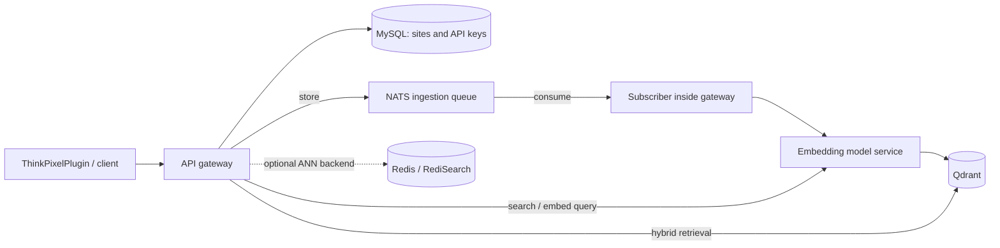

# ThinkPixelSR

**Standalone hybrid search and retrieval infrastructure for the ThinkPixel ecosystem.**

ThinkPixelSR is the continuation of [ThinkPixelInfra](https://github.com/bdobrica/ThinkPixelInfra). It provides the existing search and retrieval-augmented generation (RAG) infrastructure used by [ThinkPixelPlugin](https://github.com/bdobrica/ThinkPixelPlugin), including asynchronous document ingestion and hybrid vector retrieval. The immediate objective is **to preserve this working MVP while making it reproducible, operable, and understandable**—not to redesign its architecture.

> **Status:** Existing standalone MVP; repository migration and operator-experience makeover in progress. This is not a claim of production qualification or integration with the wider agent platform. See [PLAN.md](PLAN.md) for scope and [TODO.md](TODO.md) for the implementation sequence.

## What it does

- Exposes a search and document-ingestion API through the existing authenticated gateway.
- Accepts documents for asynchronous processing over NATS.
- Produces embeddings using the existing model containers (including Snowflake Arctic).
- Uses Qdrant for hybrid retrieval, with Redis/RediSearch retained as an existing optional alternative with different retrieval capabilities.
- Supports a WordPress search use case via the separately maintained [ThinkPixelPlugin](https://github.com/bdobrica/ThinkPixelPlugin).
- Deploys existing infrastructure to Hetzner Cloud using Terraform/Terragrunt and Kubernetes services through FluxCD GitOps.

These describe the inherited implementation, not a commitment to add new functionality.

## Architecture



The gateway hosts HTTP handlers and the subscriber. A store response means
enqueueing, not completed indexing; dev uses Core NATS without durable
JetStream. Qdrant fuses dense and sparse retrieval with RRF. Redis follows its
existing ANN path and also stores DLQ records; hybrid parity is not claimed.
See [as-built architecture and persistence](docs/architecture.md) for exact
topology and storage limits.

## Repository layout

The committed implementation has been imported from the frozen ThinkPixelInfra
revision, retaining its Git history and functional paths. See the
[Phase 1 evidence](docs/evidence/phase-1/README.md) and
[migration and rollback guide](docs/migration.md). The continuation and original
release tags are published on GitHub; the existing Flux source still points to
ThinkPixelInfra.

| Path | Existing responsibility |
| --- | --- |
| `cluster/` | Hetzner provisioning with Terraform/Terragrunt; environment roots in `cluster/live/dev` and `cluster/live/prod` |
| `k8s/` | Kubernetes declarations and FluxCD-managed workloads |
| `docker/` | API gateway, embedding models, Redis Sentinel, and WordPress image/configuration assets |
| `database/` | MySQL schema and migration artifacts |
| `local/` | Local-development resources and mock site |
| `debug/` | Debugging utilities |
| `.github/workflows/` | Existing image-publishing automation, inventoried and preserved during import |
| `docs/` | As-built architecture, configuration, deployment/operations guides, migration and verification evidence |

## Getting started

From the repository root, start with credential-free discovery:

```bash
make                         # help only
make doctor                  # local versions; no access/authentication check
make verify                  # offline checks with synthetic inputs
```

Read the [configuration guide](docs/configuration.md) and reference existing
operator credentials/SSH keys through local paths:

```bash
cp .env.example .env
# Reference existing operator credentials and SSH keys; choose dev explicitly.
make config-check ENV=dev
```

An unconfigured checkout fails on the missing secret file. Production validation
fails explicitly because its Terragrunt root is empty; it never falls back to
dev. The validator does not deploy or authenticate.

For deployment, follow [Hetzner](docs/deployment/hetzner.md), then
[Flux attachment](docs/deployment/fluxcd.md) and
[verification](docs/operations/verification.md). Authoritative state must be
located before init/plan. Initial Flux Operator/decryption installation and
compatible schema/index-node setup remain unresolved prerequisites for a fresh
cluster; the docs identify these stop points. Live dev acceptance is pending.

The inherited local entry point is `make -C local help`. Local startup/tests
mutate data and have known schema/setup gaps; inspect verification before use.

### Prerequisites

- GNU Make and Python >=3.9; Terraform >=1.10 and Terragrunt >=0.96.1 for root infrastructure wrappers, preserving checked-in provider lockfiles.
- Hetzner Cloud access and relevant DNS access; required cloud/DNS tokens.
- SSH key material matching the current Terragrunt configuration.
- kubectl with Kustomize for cluster/render commands; Docker Buildx and a prepared multi-platform builder for image commands. Flux CLI is optional; the wrappers use the existing Flux Operator.
- A container registry and permission to push model images when publishing images.
- A secure location for credentials and Terraform state; do not commit secrets, private SSH keys, `.env`, generated kubeconfigs, or state.

### Operator workflow (implemented; live dev acceptance pending)

```bash
git clone https://github.com/bdobrica/ThinkPixelSR.git
cd ThinkPixelSR
# Configure existing credentials/SSH paths using docs/configuration.md.
make help
make doctor
make verify
make config-check ENV=dev
make cluster-plan ENV=dev DRY_RUN=1  # local configuration required; no tools run
# Follow the command guide for state review, private artifacts and approval.
```

The `.env` schema accepts selector/credential/key paths; cluster inputs, Flux
sources and image identities retain their existing authority. Do not source
`.env` or expand credentials into logs. See the
[command reference](docs/operations/commands.md) for invocation/approval details
and [wrapper evidence](docs/evidence/phase-3/README.md) for offline coverage and
remaining live gates. No actual apply, attach, push or scaling is authorized
merely by the examples.

### Implemented operational targets

| Target | Expected meaning | Risk |
| --- | --- | --- |
| `help`, `doctor`, `config-check` | Discover tasks, check tools, validate local configuration | Read-only |
| `cluster-init`, `cluster-plan` | Initialize and preview the chosen Terragrunt environment | No intentional infrastructure mutations (init may modify local metadata / backend setup) |
| `cluster-up` | Apply a reviewed plan to create/update Hetzner infrastructure | Changes live resources |
| `cluster-scale` | Plan a persisted **worker-pool** count change; use guarded cluster-up after review | Plan only; later apply may replace/remove workers |
| `flux-check`, `flux-bootstrap` | Inspect readiness; guarded attachment to an existing Flux operator | Attach can start workload reconciliation; no new Git source |
| `images-build`, `images-push` | Export private multi-platform OCI archive / publish checked-in version tag | Build uses downloads/local artifacts; push may replace a registry tag |
| `status`, `verify` | Summarize live readiness / run offline checks | Status requires explicit context; verify uses synthetic inputs |
| `verify-live` | Opt-in HTTPS gateway liveness/database readiness | Reviewed dev endpoint only; no ingestion or plugin test |

No destroy target, no `-auto-approve`, and no implicit worker-pool shrink. Saved
plans bind inputs and require their reviewed SHA plus explicit confirmation.
Persist scaling changes in the existing worker input, inspect every affected
pool, and acknowledge deletions/reductions. Live dev apply, reconciliation,
image push/pull and scaling acceptance remain pending; prod is blocked.

## Documentation

| Need | Guide |
| --- | --- |
| Understand request paths and data ownership | [As-built architecture](docs/architecture.md) |
| Configure paths, credentials, precedence and dev/prod selection | [Configuration](docs/configuration.md) |
| Find exact targets, approvals and side effects | [Make command reference](docs/operations/commands.md) |
| Provision or reconnect dev safely | [Hetzner deployment](docs/deployment/hetzner.md) |
| Check/attach existing Flux and inspect source ownership | [Flux deployment](docs/deployment/fluxcd.md) |
| Build/publish versioned images and check platforms/digests | [Images](docs/operations/images.md) |
| Review worker count changes, storage/drains and recovery | [Scaling](docs/operations/scaling.md) |
| Run offline checks, health and actual WordPress acceptance | [Verification](docs/operations/verification.md) |
| Diagnose infrastructure, GitOps, queue, models and retrieval | [Troubleshooting](docs/operations/troubleshooting.md) |
| Preserve lineage, stage source cutover and switch back | [Migration](docs/migration.md) |
| Review candidate changes and remaining acceptance gates | [Unreleased operator notes](docs/releases/operator-makeover.md) |

The guides reflect implemented commands and source behavior; they do not claim
a completed live deployment/plugin run. Fresh bootstrap/schema prerequisites
and all live acceptance gaps remain explicit. [Phase 4 evidence](docs/evidence/phase-4/README.md)
records documentation checks and the deployment gate still awaiting verification.

Frozen inventories remain available for
[infrastructure](docs/baseline/infrastructure.md),
[GitOps/storage](docs/baseline/gitops.md) and
[images](docs/baseline/images.md). Evidence covers
[baseline and blockers](docs/evidence/phase-0/README.md),
[retained history/import](docs/evidence/phase-1/README.md),
[configuration](docs/evidence/phase-2/README.md) and
[Make wrappers](docs/evidence/phase-3/README.md).

[Phase 5 validation](docs/evidence/phase-5/README.md) adds a repeatable frozen
source/limited secret audit and unapplied cutover/catalog review patches. Live
deployment/plugin/scaling and source recovery remain pending; no cutover or
release is claimed. The audit requires a full history checkout.

## Relationship to ThinkPixel

[ThinkPixel](https://github.com/bdobrica/ThinkPixel) catalogs Search/RAG as an **adjacent**, independently maintained component. ThinkPixelSR does not take responsibility for agent governance, agent runtime, tool enforcement, model-provider gateway, or durable agent memory. Any future cross-component integration requires a separate proposal; it is **out of scope** for this repository makeover.

## Development and contribution

Review [AGENTS.md](AGENTS.md) before making changes. The makeover should primarily modify documentation, build/deploy wrappers and configuration templates. Preserve running service behavior, APIs, data formats, manifests' logical topology, and resource naming unless a change is narrowly necessary and approved. Keep individual changes reviewable, test existing behavior first, and record validation evidence.

## Lineage and license

Derived from [bdobrica/ThinkPixelInfra](https://github.com/bdobrica/ThinkPixelInfra),
with its original commit authorship and release tags retained. The inherited
[Apache-2.0 LICENSE](LICENSE) is unchanged. The WordPress plugin is a separate
codebase: [bdobrica/ThinkPixelPlugin](https://github.com/bdobrica/ThinkPixelPlugin).
