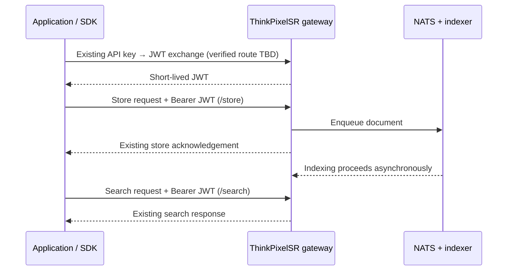

# ThinkPixelSR clients

Official, small language clients for the existing [ThinkPixelSR](../README.md) Search/RAG gateway. The goal is to make the working integration demonstrated by [ThinkPixelPlugin](https://github.com/bdobrica/ThinkPixelPlugin) available to other applications without requiring developers to implement the HTTP authentication and ingestion/search flow themselves.

> **Status: planned.** The Python, TypeScript and PHP packages, sample calls and public registration flow described here are target capabilities, **not** evidence that SDKs or new API endpoints exist. See [PLAN.md](PLAN.md) and [TODO.md](TODO.md). Actual endpoint details must be verified against the gateway and plugin source before coding.

## Scope

Each client will provide:

- **API-key authentication:** accept an existing API key and exchange it for the gateway-issued JWT using the existing authentication contract.
- **JWT lifecycle:** cache the token in memory, reuse it while valid, acquire a replacement when needed, and retry an authenticated request at most once after an authentication failure when safe.
- **Document storage:** submit documents to the existing `/store` API, returning its real acknowledgement/status. The implementation must respect the asynchronous NATS indexing pipeline: an accepted submission is **not** proof that a document has been indexed or is searchable.
- **Document search:** invoke the existing `/search` API, preserving supported hybrid-search options and response metadata without inventing search capabilities.
- **Key registration:** expose an API-key enrollment flow once a secure, explicitly designed **public registration endpoint** is implemented on the gateway. Registration is not the same operation as exchanging an existing key for a JWT.
- **Consistent errors:** distinguish invalid credentials, authorization failure, validation, rate limits, timeouts, transient network/server failures and unsuccessful registration.

## Proposed directory structure

```text
clients/
├── README.md
├── PLAN.md
├── TODO.md
├── contracts/             # Verified API contract and shared fixtures (planned)
├── python/                # Python package and examples (planned)
├── typescript/            # Node.js/browser-compatible TS package (planned)
└── php/                   # Composer package and examples (planned)
```

Each package should contain its own README, dependency manifest, examples, tests and release notes. Language-specific packaging must not force new infrastructure services.

## Intended developer experience

All three SDKs should expose the same **conceptual** operations, while following their language conventions:

| Concept | Python | TypeScript | PHP |
| --- | --- | --- | --- |
| Construct with gateway URL and API key | `ThinkPixelSRClient(...)` | `new ThinkPixelSRClient(...)` | `new ThinkPixelSRClient(...)` |
| Exchange API key for JWT | `authenticate()` | `authenticate()` | `authenticate()` |
| Submit document(s) | `store(...)` | `store(...)` | `store(...)` |
| Search indexed documents | `search(...)` | `search(...)` | `search(...)` |
| Register a new API key | `register_key(...)` | `registerKey(...)` | `registerKey(...)` |

**Names above are proposed SDK APIs, not verified server routes or working code.** Parameter names, single/batch behavior and return objects are to be finalized from real gateway/plugin contracts. Automatic authentication on the first protected request is encouraged, with an explicit method for operators who need it.

### Client configuration

At minimum: `base_url`, `api_key` (for an existing key), request timeout, and optional HTTP transport injection for tests. Support secure HTTPS endpoints by default. Allow registration before an API key exists **only** if the public endpoint and its proof/authorization requirements are satisfied. Do not embed API keys in source, browser bundles, URLs, logs, errors, analytics or example output.

**Browser caveat:** an API key included in publicly shipped frontend TypeScript is exposed to users. Browser support must not imply safe embedding of a privileged key. Prefer server-side TypeScript or a trusted backend proxy; document CORS and safe credential handling before claiming browser compatibility.

## Authentication and data flow



The model/embedding and vector search path remains entirely server-side; clients do not implement their own embedding or retrieval logic.

## Public key registration (planned server dependency)

A new **unauthenticated-to-start** registration endpoint is needed to obtain an initial API key. *Publicly reachable must not mean unrestricted self-issuance of credentials.* The design and acceptance gate are in [PLAN.md](PLAN.md).

Proposed lifecycle:

1. The calling application initiates registration with the **approved proof** required by the deployment (e.g., an operator-issued invitation or verified identity). The exact proof mechanism is a server-side design decision.
2. The server verifies that proof, applies abuse controls, creates a scoped/tenant-bound key using existing auth storage and returns it securely **once**, or initiates a verification flow.
3. The application stores the key securely and invokes normal key-to-JWT authentication.
4. Operators can disable open enrollment, revoke keys, and audit registrations.

Until the server contract is approved and implemented, SDK `register*` methods must be marked unavailable or clearly gated; **never** simulate registration by directly writing to MySQL or invent a client-side key.

## Compatibility and quality

- **Canonical behavior:** [ThinkPixelPlugin](https://github.com/bdobrica/ThinkPixelPlugin) and the existing gateway. Record actual paths, methods, authentication headers, schemas, response codes and examples in `contracts/` before writing implementation.
- **Contract-first parity:** run one shared fixture suite against all three SDKs; test JWT renewal, 401 handling, timeouts, 429/5xx, invalid JSON, async store acknowledgement and search result fidelity.
- **No backend redesign:** do not modify `/store`, `/search`, MySQL, NATS, Qdrant, embedding models, Terraform or FluxCD for SDK convenience. The only intentionally proposed backend addition is a narrow, reviewed registration endpoint and its necessary security controls.
- **Publishing:** use PyPI, npm and Packagist only after packages are validated and separately versioned. Avoid implying that unregistered package names are already published.

## Delivery roadmap

1. Inventory existing gateway and ThinkPixelPlugin protocol; capture fixture responses.
2. Approve a minimal registration threat model and server contract.
3. Build the shared conformance fixtures; implement the public endpoint securely.
4. Implement and test Python, then TypeScript, then PHP against the same contract.
5. Add real quickstarts, CI, packaging, integration testing and release gates.

See [TODO.md](TODO.md) for the ordered, checkable implementation tasks.

## Related documents

- [ThinkPixelSR root README](../README.md)
- [ThinkPixelSR repository plan](../PLAN.md)
- [ThinkPixelSR coding-agent instructions](../AGENTS.md)
- [Client implementation plan](PLAN.md)
- [Client task checklist](TODO.md)
