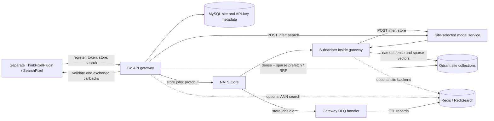
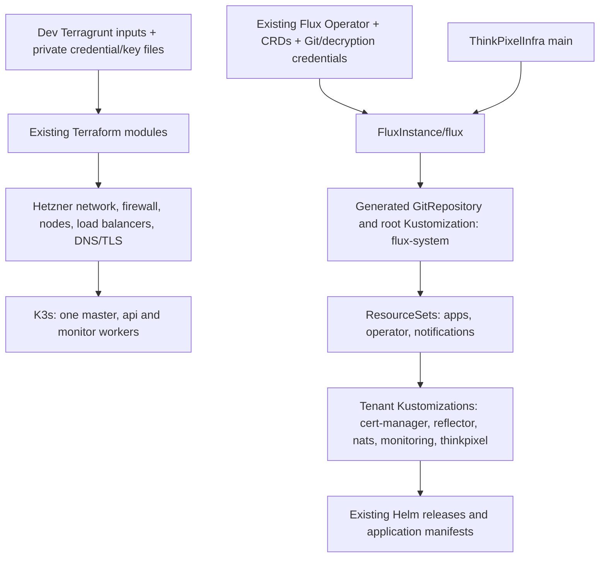

# As-built architecture

This is the as-built **source inventory**, not evidence of a running deployment.
P0-01 and P0-05 describe ThinkPixelInfra at commit
`9e5fc87495832d3a2554965341cbeb43911ff5f5`, inspected on 2026-10-11.
Phase 1 imported that committed implementation and retained its Git history.
Every implementation path below now also exists relative to the ThinkPixelSR
root; `../ThinkPixelInfra` remains the unchanged reference checkout. See the
[import comparison](evidence/phase-1/README.md) and [migration guide](migration.md).
The [frozen source tree](https://github.com/bdobrica/ThinkPixelInfra/tree/9e5fc87495832d3a2554965341cbeb43911ff5f5)
and [complete file inventory](evidence/phase-0/source-tree.tsv) identify that baseline.
No accepted ADRs or published contracts were found in its tracked tree.
Phase 4 checks this description against the imported source and the implemented
[operator commands](operations/commands.md). Deployment and plugin smoke remain
unverified; this document describes implementation, not production qualification.

## Responsibilities and command inventory

“Owner” here means the component responsible for the artifact, not a newly
assigned person. No CODEOWNERS file exists in the frozen source.

| Source path | Component owner and dependencies | Existing invocation / limitation |
| --- | --- | --- |
| `cluster/live/dev/terragrunt.hcl` | Infrastructure operator; reads `cluster/infra`, local secrets and SSH files | From that directory: `terragrunt init`, `terragrunt plan`, `terragrunt apply` in `cluster/README.md`; inspected, not executed |
| `cluster/live/prod/terragrunt.hcl` | Infrastructure operator | Empty tracked file; no reproducible prod configuration |
| `cluster/infra/` | Terraform: networking, K3s master/worker pools, firewall, load balancers, certificates, DNS/rDNS | Module graph and versions in [infrastructure inventory](baseline/infrastructure.md); no remote backend declaration |
| `k8s/flux-system/{base,dev}` | Flux Operator and Flux controllers | Declarative operator resources, Git sync and tenant reconciliation; no checked-in initial installer command |
| `k8s/apps/{cert-manager,reflector,nats}` | Helm-managed dependencies | Dev overlays consume HelmRepository/HelmRelease and generated values ConfigMaps |
| `k8s/apps/monitoring/` | Grafana, Prometheus, node exporter | Dev overlay; prod overlay empty |
| `k8s/apps/thinkpixel/` | Gateway, model services, MySQL, Qdrant, Redis, registry secrets | Dev overlay includes all six groups; prod files empty. WordPress base exists but is not included by dev |
| `docker/api_gateway/` | Go gateway, auth, registration, ingestion subscriber, retrieval, DLQ reinjection | `Dockerfile` builds gateway and `dlq-reinject`; `build-dlq-tool.sh [all]` builds tools locally |
| `docker/models/` | `mpnetv2`, `snowflake-arctic`, `e5-instruct`, `jina-v5`, `external` model services | Five Dockerfiles; `/ping`, `/infer`; only the first two have dev Kubernetes overlays |
| `docker/sentinel/` | Redis discovery | Compose builds this Dockerfile; Kubernetes uses a different stock Redis image and ConfigMap command |
| `docker/wordpress/` | WordPress admin UI/theme `thinkpixel-ui` | Dockerfile and entrypoint; separate from ThinkPixelPlugin; no checked-in publishing workflow for it |
| `database/` | Gateway site/key/index-node metadata | Base SQL v0.1.0; patches v0.1.8 and v0.2.0; `bash database/init.sh` mutates a database and has a version-table mismatch |
| `database/examples/` | Example database fixture | Separate SQL file; not loaded by local Make or a Kubernetes init job; do not import as a live baseline |
| `local/` | Disposable developer stack | `make -C local help`; Compose, SQL fixture, Flask mock callbacks; `make -C local up-build` and `db-init` change local resources |
| `local/tests/` | Integration checks | Seven scripts: API, auth/store/search, database/NATS, DLQ reinjection, graceful shutdown, metrics, store handler; require a running disposable stack |
| `debug/` | Operator Redis extraction | `redis-extractor.sh` creates/deletes Kubernetes resources and exports data; its `-P` argument puts a password in process arguments. Not a read-only verification command |
| `.github/workflows/build-and-push-image.yml` | Image publisher | Main-branch push + changed `.bumpversion.cfg`; Quay credentials, QEMU, Buildx, two platforms; see [image map](baseline/images.md) |
| `.pre-commit-config.yaml`, `.pre-commit-hooks/` | Source checks | Black/isort/flake8 and basic file/YAML hooks configured; custom `thinkpixel-hooks.py` exists but is not referenced in the hook config |

Other tracked artifacts include Apache-2.0 `LICENSE`, `.gitattributes`, editor
settings, component READMEs, changelog and version files. The source working tree
also contains ignored local credentials and an untracked gateway ZIP; none were
copied into this baseline. Inventory and verification use tracked files only.

## Dependency and request paths

The gateway hosts both HTTP handlers and the NATS consumer; there is no separate
ingestion deployment. `main.go`, `handlers/`, `register/`, `auth/`,
`document_queue/`, `model/`, `qdrantconn/` and `redisconn/` under
`docker/api_gateway/api_gateway/` are the implementation pointers.

Registration stores a pending site in MySQL, calls back to its validation route,
then posts an API key and nonce to the exchange route. The API key is hashed with
SHA-256 for lookup. `POST /auth/token` uses `X-API-Key` and returns `token` and
`exp`; generated HS256 JWTs last 15 minutes and contain the plaintext API key in
`sub`, so tokens and authentication bodies must stay out of evidence. Protected
handlers use `Authorization: Bearer <token>` and recover site/model/backend
settings through the in-memory key cache backed by MySQL.

`POST /store` accepts an array of `{id, text, language?, extra?}`. A 202 response
means at least one protobuf document was published, **not** that indexing
finished. Counts, pending IDs and optional failures distinguish partial success.
NATS Core is used (`jetstream.enabled: false` in dev); the gateway calls ordinary
`Publish`/`Subscribe`, not a queue group or durable JetStream consumer. The
subscriber is toggled by model latency and retries failures before publishing
to a DLQ subject. Do not infer durable delivery or exactly-once indexing.

The subscriber calls `http://<site model>:8000/infer` with store mode and the
site's chunk size/overlap. It writes Qdrant collections named `site_<site ID>`,
with cosine dense vectors, IDF sparse vectors and points keyed by document ID
and offset. Qdrant payloads retain `site_id`, `post_id`, `offset`, `text`;
arbitrary `extra` fields are not returned by this retrieval implementation.
Search embeds the query, prefetches named sparse/dense vectors, and fuses with
RRF. Its JSON result items have `id`, `text`, `score`. The upstream README's
“BM42 reranking” label does not establish a separate reranker; the code calls
Qdrant RRF. Redis uses its existing ANN path and has no claimed hybrid parity.
Redis also serves DLQ records even when a site's search backend is Qdrant.

## HTTP surface and compatibility gate

| Route | Method / protection | Baseline role |
| --- | --- | --- |
| `/ping`, `/ready`, `/metrics` | GET, unprotected | Liveness; readiness checks MySQL only; Prometheus metrics |
| `/register` | POST, unprotected | Pending registration and asynchronous callbacks |
| `/auth/token` | POST, `X-API-Key` | API-key-to-JWT exchange |
| `/store`, `/store/max_batch_text_size` | POST, JWT | Publish documents; batch-size guidance handler has a context-type mismatch |
| `/search` | POST, JWT | Query embeddings and site-selected retrieval |
| `/remove/embedding`, `/remove/embeddings` | POST, JWT | Remove one document (`id` string) or several (`ids` strings) |
| `/remove/embedding_by_offset`, `/remove/embeddings_by_offset` | POST, JWT | Remove specified chunks |
| `/refresh/apikey` | POST, JWT | Key rotation handler has the same context-type mismatch; recorded as a follow-up |
| `/dlq/stats`, `/dlq/messages` | GET, JWT | Site DLQ inspection, potentially sensitive payloads |

The separate sibling ThinkPixelPlugin at
`b8f64d05cbe11a58dbf7f7dcee0f5dce271d7d63` implements SearchPixel v1.4.5.
Its `searchpixel/class/core/{strings,api,rest}.php` supplies the real client flow:
registration -> WordPress validation/exchange -> token -> batch indexing ->
search. Kubernetes config uses `/searchpixel/v1/` callbacks matching that
plugin; gateway defaults and the local mock use `/thinkpixel/v1/`. The plugin
checks `stored_ids` then falls back to submitted IDs, while the gateway reports
`pending_ids`. A plugin “processed” mark therefore cannot prove indexing.
The batch-size handler also reads `db.APIKeyDetails` where middleware supplies
`auth.CacheEntry`, and its `size` response schema differs from the plugin's
`max_batch_text_size` expectation. The plugin falls back to 1024 bytes on missing
guidance; this is a compatibility gap, not a validated sizing contract.
No plugin code or interface was changed. See the [smoke specification](operations/verification.md)
for the API checks and actual WordPress acceptance gate.

## Persistence and exposure

The [GitOps inventory](baseline/gitops.md) records volumes, secrets, images,
namespaces and source references. MySQL and Qdrant use local-path PVCs;
monitoring uses hostPath PVs; Kubernetes Redis deployments do not declare data
PVCs. Local Compose has named MySQL, Qdrant and Redis volumes. These layouts
are different and do not establish a backup or storage failover guarantee.
Gateway and Grafana are exposed through existing NodePorts and Terraform load
balancer services, not a checked-in Ingress. Fluent Bit ships request logs to
configured object storage; those logs and DLQ exports can contain payloads.

| Data / owner | Dev Kubernetes persistence | Operational consequence |
| --- | --- | --- |
| MySQL site registrations, hashed keys, node allocation and dead-letter metadata | One `mysql` replica; `mysql-data` local-path RWO claim, 5Gi, `/var/lib/mysql` | Schema initialization and node records are external prerequisites. Preserve the bound PV/node and a verified database backup |
| Qdrant vectors and document text | Three dev `qdrant` replicas; `qdrant-storage` local-path RWO claim template, 1Gi per replica | Replica count alone does not establish collection replication, backup or node-loss recovery |
| Qdrant snapshots/restoration | Two additional 1Gi local-path RWO claim templates plus explicit `qdrant-snapshots` / `qdrant-snapshot-restoration` claim references | Inspect actual binding and mounts before relying on snapshots; no proven snapshot/restore runbook is checked in |
| Redis ANN indexes and TTL DLQ records | Master/replica/sentinel deployments, no data PVC | Append-only configuration does not preserve data across pod/node replacement; Qdrant-backed sites still use Redis for the DLQ |
| NATS ingestion | Core NATS, JetStream and clustering disabled | No durable queue/PVC guarantee; publication while the consumer is absent can lose work |
| Gateway request/DLQ logs | `emptyDir`; Fluent Bit also uses `emptyDir` and exports to configured object storage | Local logs disappear with pods; exported logs and payloads require private custody |
| Model assets | MPNetV2/Arctic image layers, no data PVC | Image pulls and available CPU/memory determine startup; weights are not cluster backups |
| Grafana / Prometheus | RWO hostPath PVs, 5Gi `/mnt/data/grafana`, 10Gi `/mnt/data/prometheus` | Inspect node placement and PV binding; a matching directory on another node is not the original data |
| Authentication material | External Git Secret, generated/reflected NATS TLS/nkey Secrets, checked-in SealedSecret ciphertext | Recovery requires original decryption keys and external credential custody; ciphertext alone is insufficient |
| Infrastructure ownership | Terraform state in the operator's authoritative backend/cache/workspace | No remote backend is declared here; state is sensitive and must be located before init/plan |

Local Compose instead has named MySQL, Qdrant and Redis volumes and a mock
callback service. It uses different database/vector image versions and is not
the dev Kubernetes topology. [Verification](operations/verification.md) records
its schema/setup limitations.

## Provisioning and GitOps ownership

The default dev master and four workers are `cax21` (ARM64); `api` has three
workers, `monitor` one. Cloud-init installs unpinned K3s, uses user `cluster`,
joins nodes over SSH, and taints workers with the configured domain/pool.
Workload tolerations do not prove exclusive pool placement. All worker pools
share one Terraform count-indexed resource: changing api can replace monitor
nodes. [Scaling](operations/scaling.md) requires review of every affected node.

The root Make interface selects existing roots and delegates to those tools.
Its Flux attach applies only the root overlay to an already installed operator;
tenant reconciliation remains Flux-owned. The Git source and notification
destination still reference ThinkPixelInfra. Publishing ThinkPixelSR or selecting
ENV does not switch that source. See [Hetzner deployment](deployment/hetzner.md),
[Flux ownership](deployment/fluxcd.md) and [controlled migration](migration.md).

Manual prerequisites remain cloud/DNS credentials, SSH keys, state custody,
cluster access, Flux Operator/CRDs, Git credentials, Sealed Secrets controller
and its decryption key, registry credentials, database initialization/index-node
allocation, DNS/TLS, and a reachable WordPress site. Their presence in source
does not prove successful installation. The [evidence and blocker record](evidence/phase-0/README.md)
separates observed offline results from these unverified deployment assumptions.
